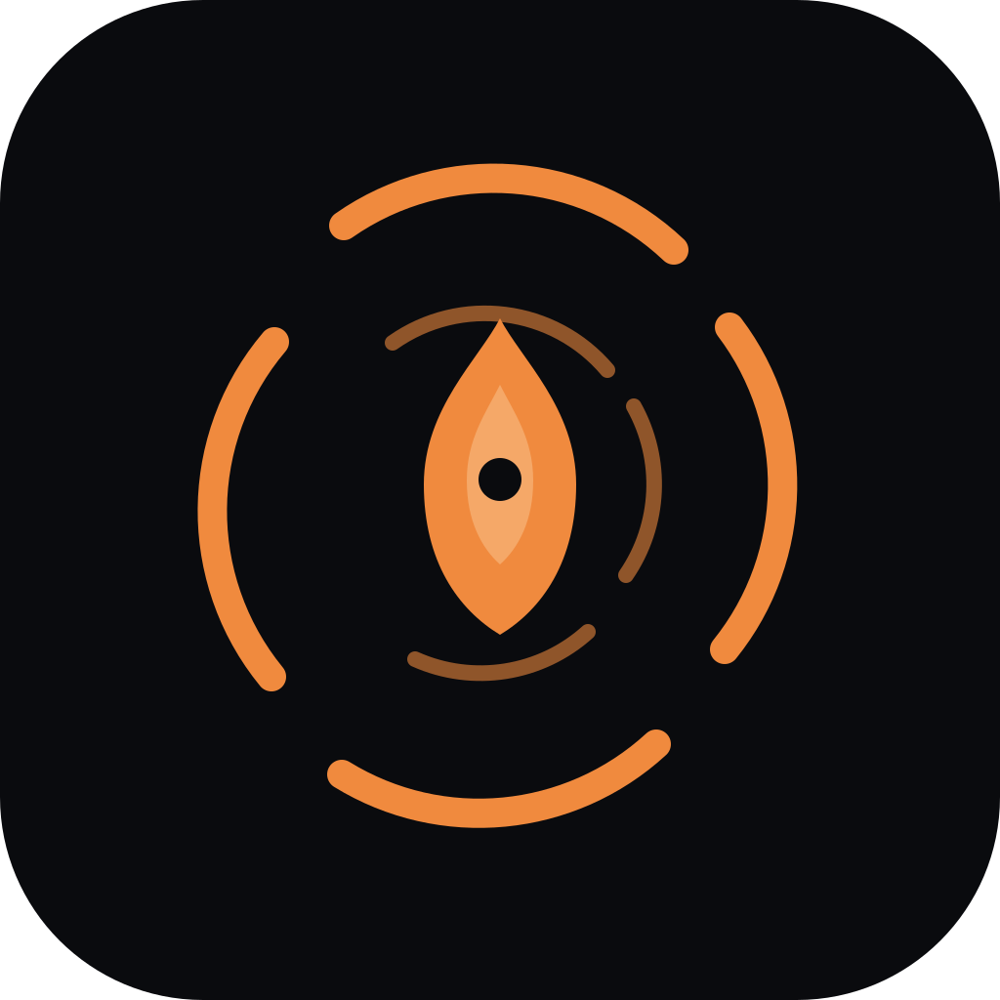

<p align="center">
  
</p>

<h1 align="center">Ekagra</h1>

<p align="center">
  Focus sessions tied to your day plan, on your phone, in the terminal and on a desk button.<br />
  The server owns the clock, and every focus session belongs to a planned task.
</p>

<p align="center">
  <a href="https://github.com/Anuraj-dev/ekagra/releases/latest">Android APK</a>
  ·
  <a href="#getting-started">Getting started</a>
  ·
  <a href="#documentation">Docs</a>
</p>

Ekagra is a focus app built on one rule. No task, no timer. You commit a few tasks for the day, then start a focus session on one of them. A work period runs 25 minutes by default, followed by a 5 minute break. After every fourth completed work period you get a 15 minute long break.

Ekagra has four clients that share one backend: an Expo app for Android and iOS, a Vite web app, a Bun terminal CLI, and an ESP8266 desk device with a 16x2 LCD. The backend is Supabase, with Postgres and row level security plus Deno edge functions. You run it against your own Supabase project. The clients need the project URL and anon key, and the desk device needs a device token.

Version 0.1.6 is the current release. Life-OS planning, covering identities, plans and commitments, is in progress. The schema and a plans API are in place, and `docs/specs/002-life-os-reimagining.md` tracks the rest.

## What you get

- **The timer runs on the server.** The `sessions` edge function owns start, pause, resume, complete and abandon. Remaining time comes from server timestamps, so the countdown does not depend on the phone's clock. The database allows one active session per owner.
- **No task, no timer.** A session row requires a `task_id`, and the core timer refuses to start without one. The same check runs in the client, the edge function and the database.
- **Honest minutes.** An abandoned session still counts the whole minutes you worked, rounded down. Abandoning requires one tag: `distraction`, `interruption` or `energy`. Only a completed work period earns a block. Completing requires the timer to reach zero, except that a work period can be finished early on purpose.
- **Four work periods, one long break.** The timer moves to a 5 minute short break after each completed work period and to a 15 minute long break after the fourth.
- **A desk button.** The ESP8266 polls `device-poll` and shows the countdown. A press starts the next planned task when no session runs, and pauses the session when one does. Pair a device from Settings in the app. The server stores only a SHA-256 hash of the device token.
- **Morning commit and evening close.** The morning commit saves the day's tasks through `commit_morning_plan`. The evening close records whether the plan matched, an optional reason tag and an optional note. Cue reminders default to 08:30 and 21:00 and can be changed in the app.
- **One forgiveness token a week.** Each ISO week, which starts Monday in UTC, grants one token. Applying it counts your most recent missed day as met. The streak counts consecutive met days. The `never_miss_twice` flag turns on when the last two days are both missed, and the motivation endpoint also returns 7 and 30 day completion rates.
- **One contract for every client.** `packages/core` holds the timer engine and the JSON contract with its validators. A vendored copy lives in `supabase/functions/_vendor/core`, and CI fails when that copy drifts from `scripts/sync-core-vendor.sh`.

## Getting started

| Platform | How you get it |
| --- | --- |
| **Android** | [Latest release APK](https://github.com/Anuraj-dev/ekagra/releases/latest). Release builds point at the maintainer's Supabase project. Build from source to use your own backend. |
| **iOS** | [Build from source](#android-and-ios-from-source) |
| **Web** | [Run the Vite dev server](#web) |
| **Terminal** | [Run the Bun CLI](#terminal) |
| **Desk device** | [Flash the ESP8266 firmware](#desk-device) |

Each route needs a Supabase project and a checkout of this repository. Run `bun install` once from the repository root, then set up the backend.

### Set up Supabase

Run these from the repository root. `db push` asks for your database password, and `functions deploy` deploys every function in `supabase/functions`.

```sh
bunx supabase link --project-ref <your-project-ref>
bunx supabase db push
bunx supabase functions deploy
```

`supabase/config.toml` turns off JWT checks for `device-poll`, `device-action` and `health`. Those endpoints authenticate with the device token instead.

### Web

```sh
cp apps/web/.env.example apps/web/.env.local
# set VITE_SUPABASE_URL and VITE_SUPABASE_ANON_KEY in apps/web/.env.local
cd apps/web && bun run dev
```

Vite serves the app at `http://localhost:5173`. The web app has Today, Goals, Insights, Crew and Tasks tabs.

### Android and iOS from source

```sh
cp apps/mobile/.env.example apps/mobile/.env
# set EXPO_PUBLIC_SUPABASE_URL and EXPO_PUBLIC_SUPABASE_ANON_KEY in apps/mobile/.env
cd apps/mobile && bun run start
```

`bun run start` starts the Expo dev server. Then run `bun run android` or `bun run ios` to open the app. To publish your own Android build, follow the steps in `.github/workflows/release.yml`.

### Terminal

```sh
cd apps/cli
bun run start -- help
bun run start -- login you@example.com
bun run start -- today
```

The CLI reads `EKAGRA_SUPABASE_URL` and `EKAGRA_SUPABASE_ANON_KEY`. It also accepts `SUPABASE_URL`, `SUPABASE_ANON_KEY` and the `VITE_` names, or `~/.config/ekagra/config.json` with `supabaseUrl` and `anonKey`. The signed-in session is saved in `~/.config/ekagra/session.json`. Commands: `capture`, `plan`, `start`, `pause`, `resume`, `done`, `abandon`, `today`, `week`, `login`, `logout` and `whoami`.

### Desk device

Follow [firmware/README.md](firmware/README.md). The short version:

```sh
cp firmware/src/secrets.example.h firmware/src/secrets.h
# fill in Wi-Fi, the Supabase URL and the device token from Settings, then:
cd firmware && pio run -t upload
```

`secrets.h` is ignored by Git.

## Configuration

| Variable | Read by | Value |
| --- | --- | --- |
| `EXPO_PUBLIC_SUPABASE_URL`, `EXPO_PUBLIC_SUPABASE_ANON_KEY` | Mobile, from `apps/mobile/.env` | Project URL and anon key |
| `VITE_SUPABASE_URL`, `VITE_SUPABASE_ANON_KEY` | Web, from `apps/web/.env.local` | Project URL and anon key |
| `EKAGRA_SUPABASE_URL`, `EKAGRA_SUPABASE_ANON_KEY` | CLI | Project URL and anon key |

Keep the service role key out of every client. Release CI reads `SUPABASE_URL` and `SUPABASE_SERVICE_ROLE_KEY` from repository secrets to upload builds.

## Development

```sh
bun install
bun run test
bun run lint
bun run typecheck
```

`bun run test` finds test files with `rg`, so install ripgrep first. Database tests in `supabase/tests` run in CI against a fresh local Supabase stack. To run them yourself, start the stack with `supabase start` and run `supabase test db`. CI runs the two `*_upgrade.sql` replay tests separately because each one resets the database to an earlier migration. After you change `packages/core`, run `./scripts/sync-core-vendor.sh` and commit the result.

## Documentation

- [Life-OS spec](docs/specs/002-life-os-reimagining.md): the planned direction and what is still in progress.
- [Design law](docs/DESIGN.md): tokens, geometry and the Warm Planning Desk II direction.
- [Decision log](docs/decisions.md): why the project is built the way it is.
- [Domain language](CONTEXT.md): Identity, Goal, Plan, Commitment, Task, Block and Session.
- [Supabase notes](supabase/README.md) and [firmware notes](firmware/README.md).
- [AGENTS.md](AGENTS.md): where to start for coding agents.
